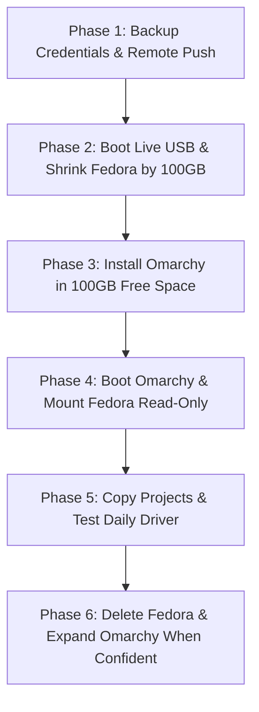

# Fedora to Omarchy Migration Plan

A zero-risk, side-by-side dual-boot migration plan to transition from Fedora 44 to Omarchy (Arch-based) without data loss.

---

## 1. Storage Baseline & Partition Layout

- **Drive**: 512 GB NVMe SSD (`/dev/nvme0n1` — 476.9 GiB raw)
- **Filesystem**: Btrfs on `/dev/nvme0n1p3` (shares `/` and `/home`)
- **Current Usage**: ~84 GB used, ~294 GB available

```
nvme0n1 (476.9G)
├─nvme0n1p1   600M   vfat   /boot/efi       (EFI system partition)
├─nvme0n1p2     2G   ext4   /boot           (Fedora kernel/initramfs)
├─nvme0n1p3 380.9G   btrfs  / and /home     (Fedora system & data)
├─nvme0n1p4    16M          Microsoft Reserved
├─nvme0n1p5  92.6G   ntfs   (Unmounted NTFS partition)
└─nvme0n1p6   845M   ntfs   (Windows recovery)
```

Targeting **100 GB** for Omarchy leaves Fedora with ~280 GB (~196 GB free), providing ample safety room.

---

## 2. Migration Workflow



---

## 3. Step-by-Step Execution

### Phase 1: Pre-Migration Backup (In Fedora)

1. **Verify Remote Git Repositories**:
   Ensure all local changes across active projects in `~/Projects` and `~/Development` are committed and pushed:
   ```bash
   git status
   git push origin main
   ```

2. **Archive Non-Reproducible Configurations & Keys**:
   Create an encrypted or offline archive for essential secrets:
   ```bash
   tar -czvf ~/credentials_backup.tar.gz \
     ~/.ssh \
     ~/.gnupg \
     ~/.config/gh \
     ~/.gitconfig 2>/dev/null
   ```
   > **Note**: Copy `credentials_backup.tar.gz` to an external USB flash drive or secure storage.

---

### Phase 2: Disk Partitioning via Live USB

> **Warning**: Never shrink the underlying block partition of an active, mounted root filesystem from within the running OS.

1. Boot into an **Omarchy / Arch Linux Live USB** (or GParted Live).
2. Open terminal or GParted:
   - Select `/dev/nvme0n1p3` (Fedora Btrfs).
   - Shrink the partition by **100 GB** from the right side.
   - Leave the resulting 100 GB as **Unallocated Space**.

---

### Phase 3: Omarchy Installation

1. Launch the Omarchy / Arch installer (`archinstall` or GUI installer).
2. Configure mount points manually:
   - **EFI**: Select `/dev/nvme0n1p1` (`/boot/efi`) -> Mount at `/boot/efi` or `/boot` (as required by the installer). **DO NOT FORMAT IT**.
   - **Root (`/`)**: Create a new partition (e.g. ext4 or Btrfs) inside the 100 GB unallocated space.
   - **Swap**: Use zram (recommended) or reuse existing zram.
3. Finish the installation and configure the bootloader (systemd-boot or GRUB with os-prober enabled).
4. Reboot into your new Omarchy install.

---

### Phase 4: Selective Data Migration (In Omarchy)

Once booted into Omarchy, mount your old Fedora partition in **read-only** mode:

```bash
# 1. Create a mount point
sudo mkdir -p /mnt/fedora

# 2. Mount the Fedora Btrfs home subvolume safely
sudo mount -o ro,subvol=home /dev/nvme0n1p3 /mnt/fedora

# 3. Restore dotfiles & repos
git clone git@github.com:titanaprilian/dotfiles.git ~/.dotfiles

# 4. Copy project directories
cp -a /mnt/fedora/titanic/Projects ~/Projects
cp -a /mnt/fedora/titanic/Development ~/Development

# 5. Restore SSH / GPG credentials from your backup drive
tar -xzvf /path/to/credentials_backup.tar.gz -C ~/
```

> **Best Practice**: Do not bulk copy `~/.cache`, `~/.local`, or old system configs. Install packages natively through `pacman` / `yay` to maintain a clean system.

---

### Phase 5: Dual-Boot Safety Period

- Keep both Fedora and Omarchy installed side-by-side for **1 to 2 weeks**.
- If any missing configuration, proprietary tool, or build environment is needed urgently, reboot into Fedora at any time.

---

### Phase 6: Final Cutover (Reclaim Whole Drive)

When Omarchy is fully verified and stable:

1. Boot into a Live USB.
2. Delete `/dev/nvme0n1p2` (Fedora `/boot`) and `/dev/nvme0n1p3` (Fedora root/home).
3. Expand the Omarchy root partition into the newly freed space across the entire NVMe drive.
